# Add a game

Add a game the catalog doesn't know, such as your own copy of a multi-disk game, and set it up yourself: group its disks, name it, choose its machine and which disk goes in each drive, and play. Everything here is done from KairoMSX's own screens, and all of it is kept.

## 1. Add the disks

Copy the game's disks (DSK…) into your games folder (a folder of their own keeps them together), then open the library menu › **Refresh**. A game the catalog doesn't know is listed under its file names, one entry per disk.

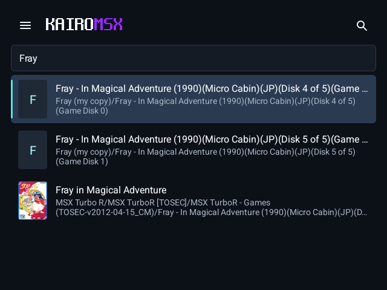

## 2. Group them into one game

Open the disk the game starts from › **Game settings** (on a two-screen device, Game settings is on the second screen). Under **Library**, **Disks** shows the game's disks.

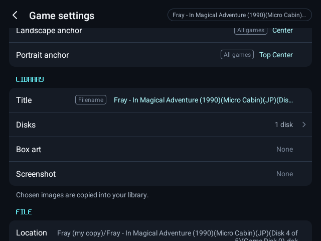

Switch on the game's other disks. They leave the library list and become this game's disks; the row reads "2 disks".

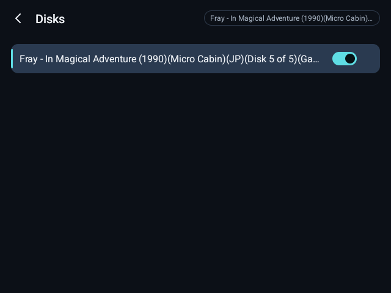

## 3. Name it

Under **Library**, **Title**: type the game's name and save. **Box art** and **Screenshot** take images from your device.

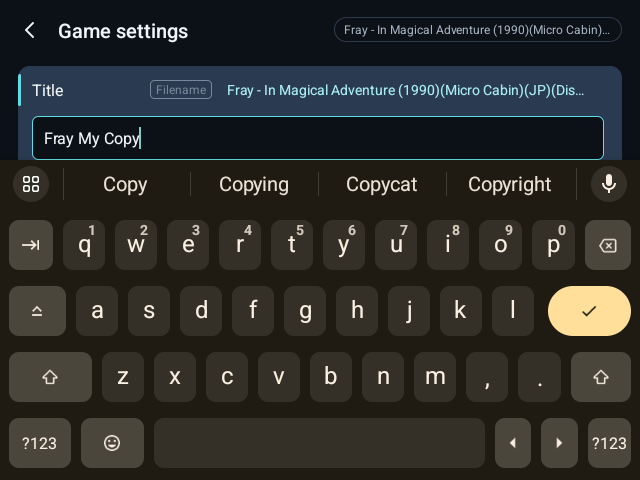

The library now lists it once, under its name.

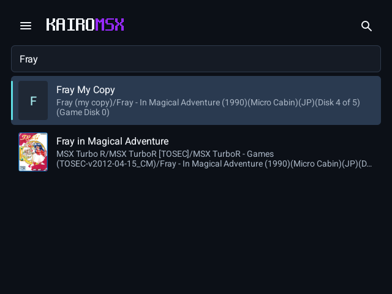

## 4. Choose its machine and drives

Under **Machine**, **Machine** picks the MSX the game needs: here the turbo R. **Automatic** can't tell for a game the catalog doesn't know.

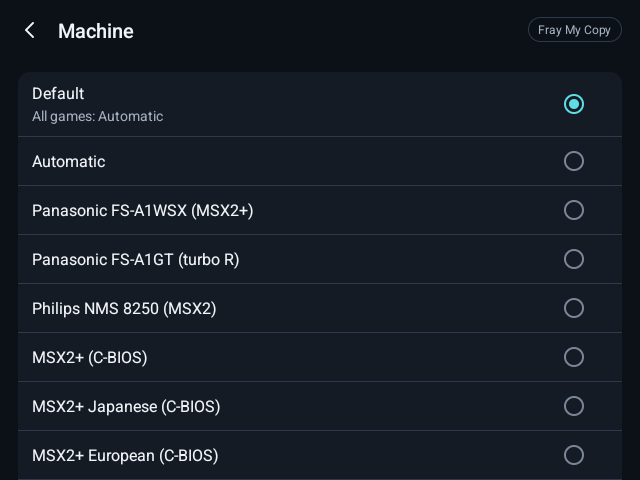

The game starts from the disk you grouped the others on, in Disk A. Put its other disk where it expects it: here **Drive B** holds the second game disk, and the MSX starts with a second disk drive for it.

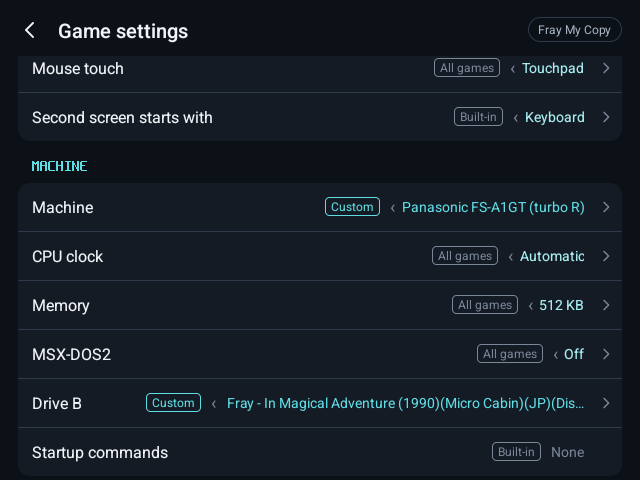

## 5. Firmware

The real MSX machines need their own firmware; the C-BIOS machines are free and come with KairoMSX. Library menu › **Machine** › **Firmware** shows, for each machine, whether each file is installed and which are required; **Import all from a folder…** finds and imports them.

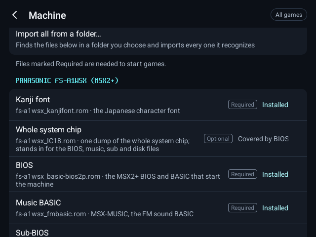

## 6. Configure

Everything else in Game settings (controls, CPU clock, memory, MSX-DOS2, display) is kept for this game alone.

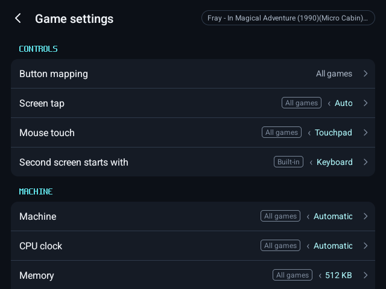

## 7. Play

Press **Play**.

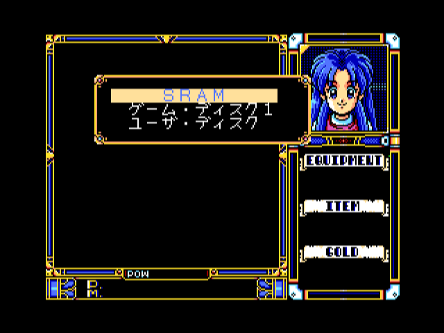

In the menu, **Media** shows each drive and slot.

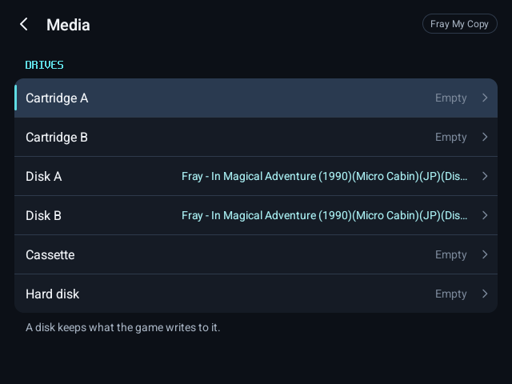

Each drive lists the game's disks first, under **This game**, for swapping when it asks.

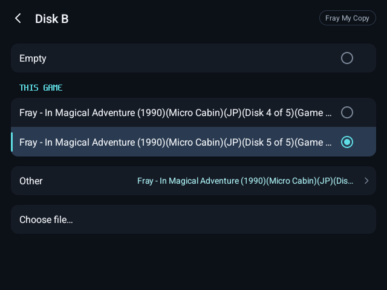

## 8. It is kept

Save your progress with **Save state**, as with any game. What the game writes to its disks is kept too.

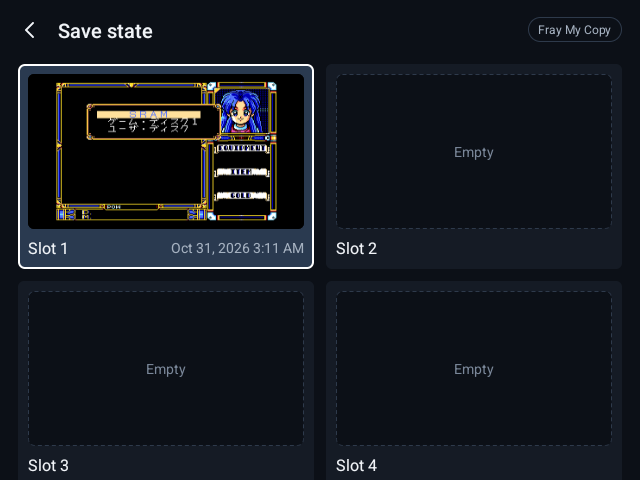

After closing and reopening KairoMSX, the game is still one game with its name, disks and settings, and **Load state** brings back your progress.

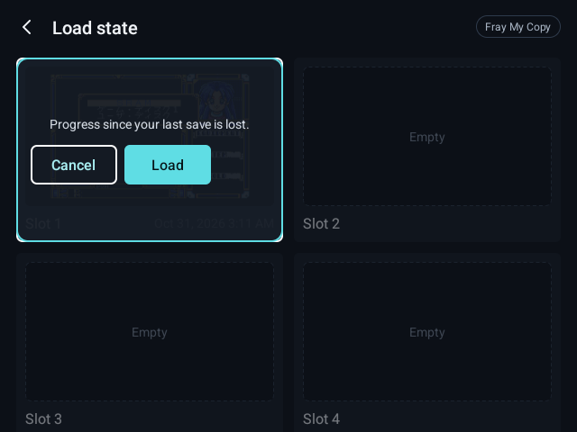
