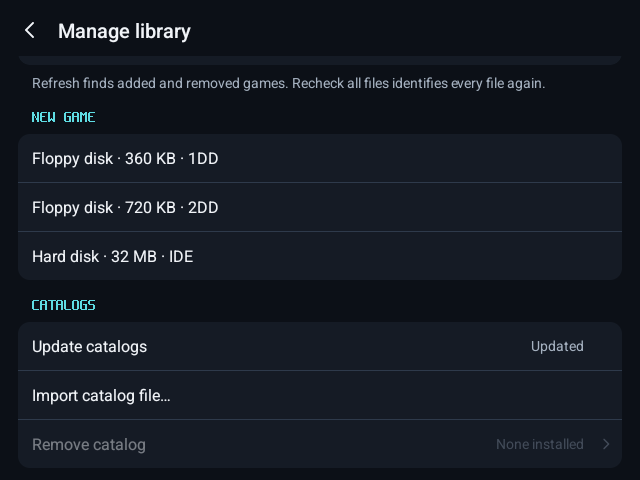
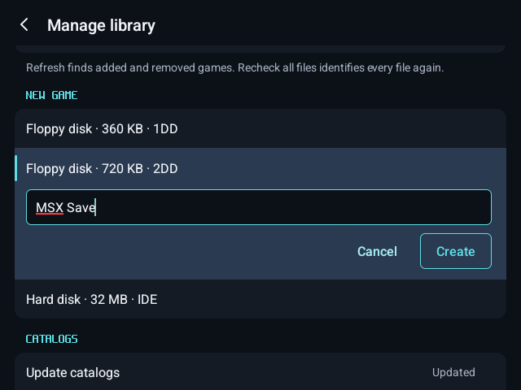
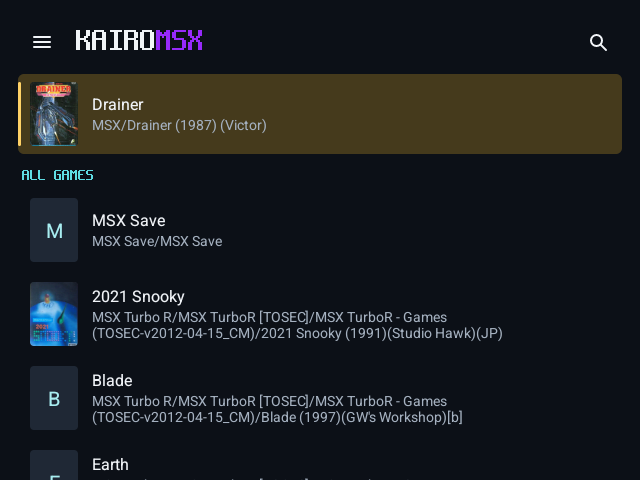
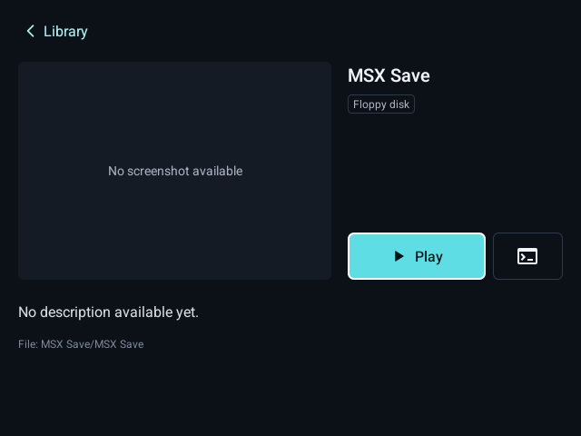
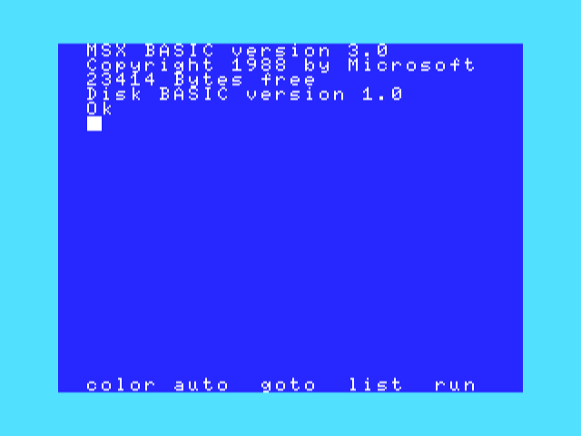
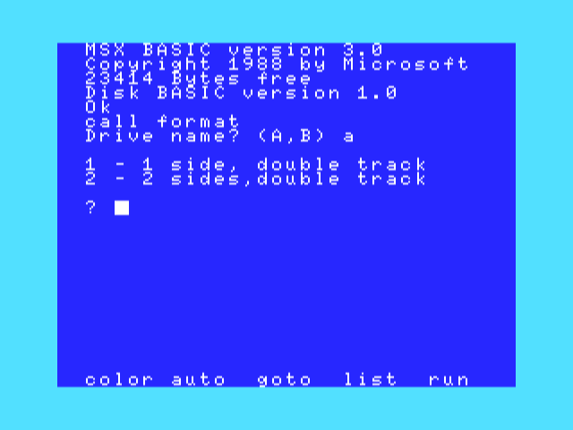
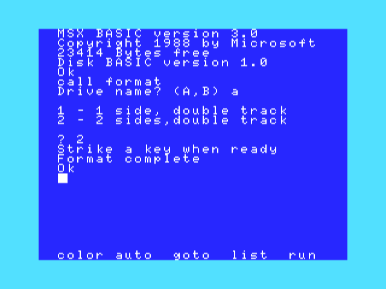
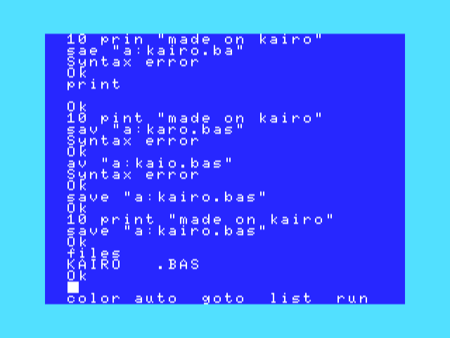
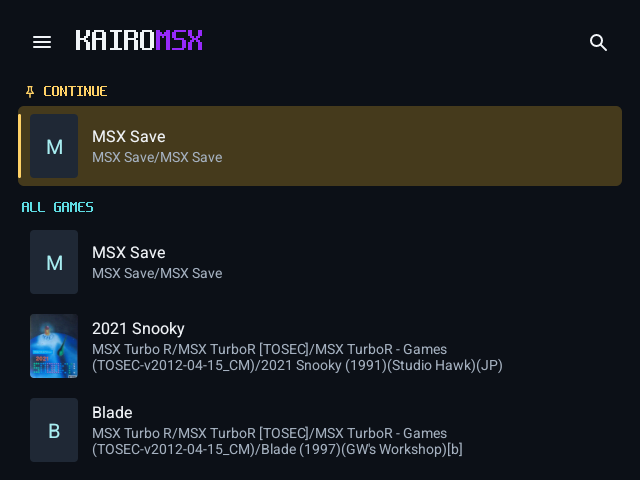
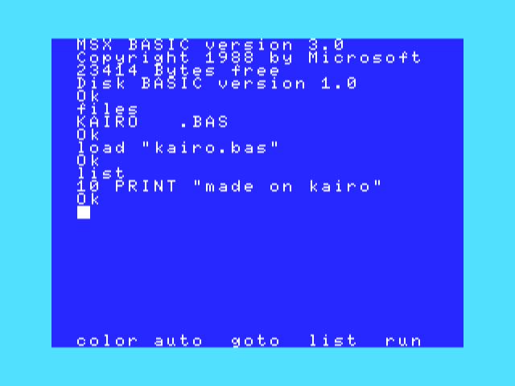

# Create a game

Make a new game on a blank disk: a save disk a game asks for, a disk of your own, or a hard disk to copy games to. KairoMSX makes the blank disk; the MSX formats it, as on the real machine. Your game disks can stay wherever they are (for example in Download): the Disks page takes them from anywhere on the device.

## 1. Create the blank disk

Open the library menu › **Manage library**. Under **New game**, choose a 360 KB (1DD) or 720 KB (2DD) floppy, or a 32 MB hard disk for the Sunrise IDE.

Name the game and press **Create**. KairoMSX makes a folder of that name in your games folder with the blank disk in it.

## 2. Start at BASIC with the disk in drive A

Open it and press the command-line button beside **Play**: MSX BASIC starts with Disk BASIC and the disk in drive A.

A game's disk goes in drive B through the menu › **Disks** › **Choose file…**, from wherever it is.

## 3. Format it

Type `CALL FORMAT`, the drive (`a`), and `2` for a double-sided 720 KB disk (`1` for a 360 KB one), then press a key.

A hard disk is partitioned with Nextor's `CALL FDISK` instead; it needs your Sunrise IDE Nextor ROM (Firmware).

## 4. Write to it

Save to it as to any disk, copy a game to it, or let a game write its saves to it. Here a program: `SAVE "a:kairo.bas"`, and `FILES` lists it.

On the on-screen keyboard, `"` and `:` are on the **?123** page.

## 5. It keeps what is written

The disk is in your library under the name you gave it.

After closing and reopening KairoMSX, the disk still holds the program: `FILES`, `LOAD "kairo.bas"`, `LIST`.

